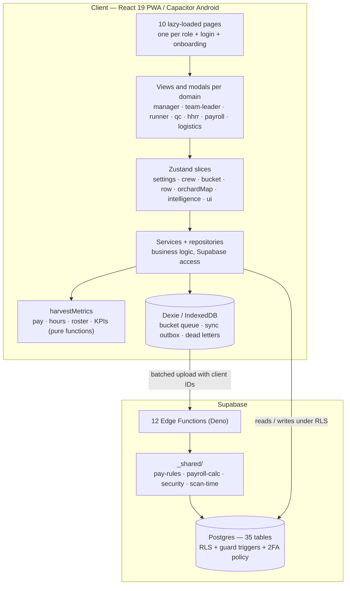

# Architecture

How HarvestPro NZ is put together, and why. Last reviewed 16 October 2026.

## Shape of the system

## Data model in one paragraph

One installation serves **one company** with several orchards. People (`pickers` — pickers, team leaders and runners) belong to the company, have a usual orchard and a team leader. What happened each day comes from `daily_attendance` (check-in, check-out, breaks) and `bucket_records` (each scanned bucket, with orchard, row and time). Weekly pay per person is the sum over every orchard they worked at; a closed week is stored in `pay_weeks` as a snapshot and its source rows are then locked by triggers.

## Offline scanning

1. The runner scans a picker's QR code. `bucketSlice` creates the record with a UUID generated on the device and writes it to IndexedDB **before** showing "saved".
2. `bucket-upload.service` sends pending scans in batches to the `record-bucket` Edge Function.
3. The function is idempotent: an ID it already has returns `duplicate`; two buckets in the same second are kept apart by a millisecond rather than dropped. Lost responses and resends therefore never double-count.
4. Phone clock drift is measured (`_shared/scan-time.ts`) and either flagged or corrected.
5. Scans the server permanently rejects stay on the device marked as failed and are logged in `rejected_scans`; managers see them in the dead-letter queue view.

Other offline writes (attendance, timesheets, contracts, QC inspections, transport) go through `sync.service` and the processors in `src/services/sync-processors/`, with optimistic locking on `updated_at` and server-wins conflict handling (`conflict.service`).

## Pay engine

- **Rules:** `src/services/harvestMetrics/pay.ts` and `supabase/functions/_shared/pay-rules.ts` are byte-identical. `pay-parity.test.ts` fails if they differ. The browser uses the rules for instant feedback; the Edge Functions are the source of truth.
- **Weekly calculation:** `_shared/payroll-calc.ts`, shared by `calculate-payroll` and `close-pay-week`, so the screen and the closed snapshot can never disagree.
- **What it applies:** piece-rate earnings topped up to the minimum wage **per day** (stricter than the per-pay-period test the law requires), an individual contract rate as the floor when higher, time-and-a-half on public holidays with alternative days, and only the breaks a team leader recorded.
- **Verification:** around 110 unit cases, plus `supabase/functions/tests/payroll_differential_week_test.ts`, which runs a realistic week against the real database and function and compares with an independent reference in `src/test/payroll-reference/`.
- **Out of scope:** PAYE, KiwiSaver, ACC levies and payslips. Gross pay is exported to Xero or PaySauce.

## Security model

| Layer                          | Mechanism                                                                                                                                                                                                    |
| ------------------------------ | ------------------------------------------------------------------------------------------------------------------------------------------------------------------------------------------------------------ |
| Identity                       | Supabase Auth; TOTP 2FA required for admin, manager, payroll and HR                                                                                                                                          |
| 2FA enforcement                | `mfa_satisfied()` checks `aal2`; a restrictive policy on every public table and on storage. Dev bypass via `security_settings.enforce_mfa` (on by default, no API grant)                                     |
| Authorisation                  | RLS on every table; role helpers (`is_role`, `is_manager`, …) read `public.users` and require an active account                                                                                              |
| Business rules in the database | Guard triggers, e.g. `guard_user_changes` (no self role change), `guard_picker_team_changes` (managers cannot add/remove/move pickers; team leaders only manage their own team; HR moves and removes people) |
| Server functions               | JWT verified, role re-read from the database, Zod validation, sanitised errors, service-role client only after authorisation                                                                                 |
| Tests                          | `supabase/tests/security/*.sql` — 769 checks, each in a rolled-back transaction (`scripts/test-db-security.sh`)                                                                                              |

## Internationalisation

Seven locales in `src/i18n/locales/` (en, es, mi, sm, to, hi, tl). `npm run i18n:check` fails the build if a key is missing in any language or placeholders do not match.

## Decisions worth knowing

- **Supabase over a custom backend:** Postgres RLS lets permissions live next to the data and be tested with SQL, which matters more here than custom server code.
- **Dexie over a sync framework:** the offline needs are narrow (append-mostly scans and a few editable records), so a small outbox with idempotent endpoints was simpler than a full replication layer. See `docs/architecture/adr-001-hybrid-state-management.md`.
- **One company per installation:** keeps policies simple. Supporting several companies in one database would need a tenant column on people, pay weeks and settings.
